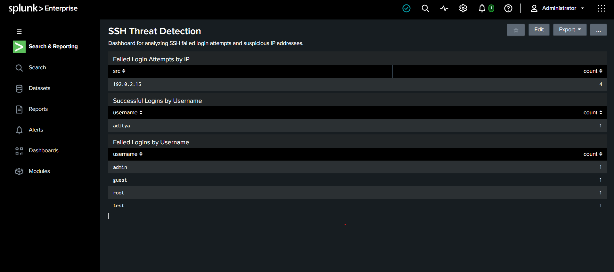

# Splunk SSH Threat Detection
## Project Overview

This project demonstrates SSH authentication log analysis using Splunk Enterprise. It identifies failed login attempts, successful logins, usernames, and source IP addresses from sample logs.

## Tools Used

- Splunk Enterprise
- SPL (Search Processing Language)
- SSH Authentication Logs

## Project Features

- Failed login analysis
- Successful login analysis
- Source IP analysis
- Username analysis
- Splunk dashboard with three panels

## Sample Findings

- Failed login attempts: 4
- Source IP: `192.0.2.15`
- Successful login: `aditya`
- Failed usernames: `admin`, `root`, `test`, `guest`

## Dashboard Screenshot



## SPL Queries

### Failed Logins by IP

```spl
index=* sourcetype=linux_secure "Failed password"
| rex "from (?<src>\d{1,3}(?:\.\d{1,3}){3})"
| stats count by src
```

### Failed Logins by Username

```spl
index=* sourcetype=linux_secure "Failed password"
| rex "Failed password for (?:invalid user )?(?<username>\S+)"
| stats count by username
```

### Successful Logins

```spl
index=* sourcetype=linux_secure "Accepted password"
| rex "Accepted password for (?<username>\S+)"
| stats count by username
```

## Disclaimer

The logs used in this project are simulated training data. The results do not represent a real cyberattack.

## Author

Aditya Guldagad

